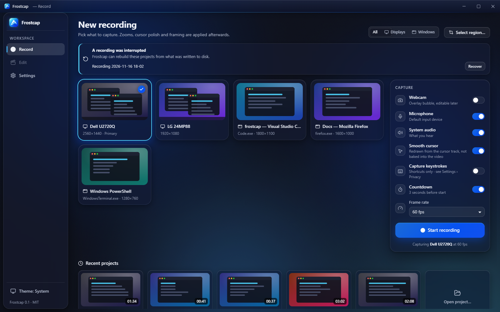
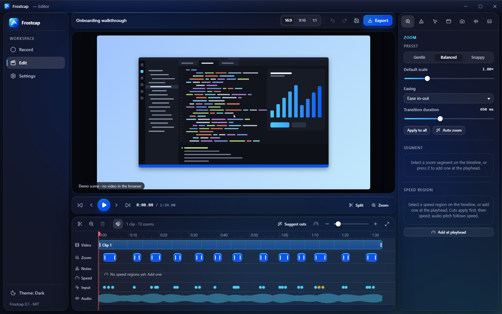

<p align="center">
  
</p>

<h1 align="center">Frostcap</h1>

<p align="center">
  A free, open-source screen recorder and editor for Windows.<br>
  Record your screen, let Frostcap zoom in where the action is, polish it, export it.<br>
  <strong>No account. No network. No telemetry. MIT licensed.</strong>
</p>

<p align="center">
  <a href="LICENSE"></a>
  
  
</p>

> **Status: early development (0.1.0, pre-release).** There is no published release yet.
> Recording works; the editor and the "baked" export are still being built. The table
> below is honest about what works today. Build from source to try it.

## Features

| Area | What it does | Status |
|---|---|---|
| Screen capture | Record a monitor or a single window via Windows Graphics Capture, cursor on/off, chosen frame rate, GPU frames go straight to the encoder | **Works** |
| Encoding | H.264 in MP4 through the Windows Media Foundation encoder (hardware encoder when available). No codecs bundled | **Works** |
| Audio | Microphone and system audio (WASAPI loopback) as separate WAV tracks, synchronised to the video | **Works** |
| Input metadata | Cursor path, clicks and focused-window changes recorded alongside the video for auto-zoom and cursor effects | **Works** |
| Keystroke capture | Off by default. Optional "shortcuts only" or "all keys" (key-downs only, for the key overlay and typing-based zoom) | Works in core; UI setting in progress |
| Auto-zoom | Generates zoom segments from clicks and typing bursts, with gentle/balanced/snappy presets | **Works** (core, unit-tested) |
| Pause / resume | Pausing removes the paused span from all tracks | In progress |
| Region capture | Draw a region of the screen to record | In progress |
| Webcam | Webcam recorded to a separate track for picture-in-picture | In progress |
| Crash recovery | Recover a recording if Frostcap or Windows stops mid-recording | In progress |
| Editor | Timeline with trims/splits, zoom segments, cursor, frame, background, captions inspector, undo/redo | UI in progress; preview does not yet play the real video |
| Export (raw) | Export the recorded `screen.mp4` with progress | **Works** |
| Export (baked) | Render zooms, background, padding, rounded corners, shadow, smoothed cursor, click ripples and key overlay into a new MP4 (GPU compositor) or GIF | **Planned / in progress** - presets currently fall back to the raw export |
| Installer | NSIS installer and portable exe | Release workflow written, not yet exercised |

"In progress" means code exists in the repository but is not finished or not wired through to
the app yet. See [docs/ARCHITECTURE.md](docs/ARCHITECTURE.md) and [docs/UI.md](docs/UI.md) for
details.

## Screenshots

_Screenshots will be added with the first release._

<!-- Put images in assets/screenshots/ and reference them here, e.g.


Do not use screenshots that show private windows, names or notifications. -->

## Privacy

Frostcap works entirely on your computer.

- It makes **no network requests**: no update checks, no analytics, no crash reporting, no
  accounts. The app's Content Security Policy only allows local resources.
- Recordings and settings stay on your disk (by default under `Videos\Frostcap`).
- Keystroke capture is **off by default**. When you turn it on, only key-downs are stored in
  the project file, never text.
- Recorded projects can contain window titles and other details; check before you share one.

Full details, including what each file contains and how to delete it: [docs/PRIVACY.md](docs/PRIVACY.md).

## Install

There is no release yet. When there is, it will be on the
[Releases](../../releases) page as:

- `Frostcap_<version>_x64-setup.exe` - installer
- `Frostcap_<version>_x64-portable.exe` - single exe, no installation
- `SHA256SUMS.txt` - checksums ([how to verify](docs/RELEASING.md#verifying-a-download))

**Requirements**

- Windows 11, or Windows 10 x64 (version 2004 or newer recommended). Windows 11 is the
  main target: on Windows 10 some capture options are limited by the OS (for example the
  capture border cannot be hidden) and the Mica backdrop is not available. Windows 10
  support is less tested.
- **Microsoft Edge WebView2 Runtime (Evergreen)**, which draws the user interface. It is
  preinstalled on Windows 11 and on up-to-date Windows 10. The installer can fetch it if it
  is missing; the portable exe needs it already installed
  ([download from Microsoft](https://developer.microsoft.com/microsoft-edge/webview2/)).
- **Windows N / KN editions** do not include Media Foundation codecs. Install the
  [Media Feature Pack](https://support.microsoft.com/topic/media-feature-pack-list-for-windows-n-editions-c1c6fffa-d052-8338-7a79-a4bb980a700a)
  first, or recording will fail.

Early builds are not code-signed, so Windows SmartScreen may show "Windows protected your PC".
Verify the checksum, then choose "More info" -> "Run anyway" if you trust the download.

## Build from source

Prerequisites (all free):

- Windows 10/11 x64
- [Rust](https://rustup.rs/) via rustup. The exact toolchain (1.100.0, with clippy and
  rustfmt) is pinned in [`rust-toolchain.toml`](rust-toolchain.toml) and installed automatically.
- MSVC build tools: "Visual Studio Build Tools" with the **Desktop development with C++**
  workload (MSVC + Windows SDK). The free Build Tools edition is enough.
- [Node.js](https://nodejs.org/) 20 or newer (CI uses 24) with npm
- WebView2 Runtime (see above)

```powershell
git clone <repository-url> frostcap
cd frostcap

# Optional: keep the Rust toolchain, cargo cache and build output inside the repo
# (useful when the system drive is small). Do this in every new shell.
. .\env.ps1

# 1. Build the UI (embedded into the exe at compile time)
cd ui
npm ci                     # with env.ps1: npm ci --cache ..\.toolchain\npm-cache
npm run build              # typecheck + vite build -> ui/dist
cd ..

# 2. Build and run the app
cargo run -p frostcap --release
```

The release binary is `target\release\frostcap.exe`. It statically links the C runtime, so it
is a single file (WebView2 is still required).

**UI development with hot reload:** run `npm run dev` in `ui/` (Vite on port 5173), then
`cargo run -p frostcap --no-default-features` in another terminal. The UI also runs in a normal
browser against a mock backend (`npm run dev`, open the printed URL), which is handy for
layout work.

**Checks** (the same ones CI runs):

```powershell
cargo fmt --all -- --check
cargo clippy --workspace --all-targets -- -D warnings
cargo test --workspace
cargo deny check                       # license policy + RustSec advisories
node scripts/gen-third-party.mjs --check
cd ui; npm run typecheck; npm run build
```

Smoke tests that touch real hardware: `cargo run -p frostcap-core --example record`
(records a few seconds of the primary monitor and validates the MP4).

**Installer:** see [docs/RELEASING.md](docs/RELEASING.md). The bundler is off in
`tauri.conf.json` for day-to-day builds and enabled only for releases.

## Notes on H.264 and WebView2

- Frostcap does **not** ship a video codec. It asks Windows' own Media Foundation for its
  H.264 (and AAC) encoder, using a hardware encoder from your GPU vendor when one is
  available. This is why N editions need the Media Feature Pack, and why there is no FFmpeg.
- The interface is a web UI rendered by the system WebView2 (Chromium-based Edge) runtime.
  Frostcap does not bundle or modify it.
- Legal background (licenses, codec patents, WebView2 terms, trademarks):
  [docs/LEGAL.md](docs/LEGAL.md). It is not legal advice.

## Project layout

```
assets/brand/            logo master (logo.png) and source
crates/frostcap-core/    capture, audio, input metadata, project format, auto-zoom (no UI)
crates/frostcap-render/  export renderer: decode -> GPU compositor -> encode, GIF (in progress)
crates/option-ext-shim/  MIT replacement for the MPL-2.0 option-ext crate
src-tauri/               Tauri 2 app shell (window, commands) -> frostcap.exe
ui/                      React + TypeScript + Vite user interface
docs/                    architecture, UI, brand, privacy, legal, releasing
scripts/                 maintenance scripts (third-party license inventory)
.github/                 CI, release workflow, templates, Dependabot
deny.toml                dependency license and advisory policy (cargo-deny)
env.ps1                  optional repo-local toolchain environment
```

A recording is a folder, `<name>.frostcap/`, holding `screen.mp4`, optional `webcam.mp4`,
`audio-mic.wav`, `audio-system.wav` and `project.json` (tracks and edits). See
[docs/ARCHITECTURE.md](docs/ARCHITECTURE.md#project-format).

## Contributing

Contributions are welcome: bug reports, testing on different hardware, code and docs.
Read [CONTRIBUTING.md](CONTRIBUTING.md) first; it covers the dependency license policy
(permissive licenses only) and the no-network rule. Please follow the
[Code of Conduct](CODE_OF_CONDUCT.md). Report security issues privately as described in
[SECURITY.md](SECURITY.md).

## License

Frostcap is released under the [MIT License](LICENSE). Third-party components and their
licenses are listed in [THIRD_PARTY_LICENSES.md](THIRD_PARTY_LICENSES.md).

The Frostcap name and logo: see the trademark note in [docs/LEGAL.md](docs/LEGAL.md#name-and-logo).
