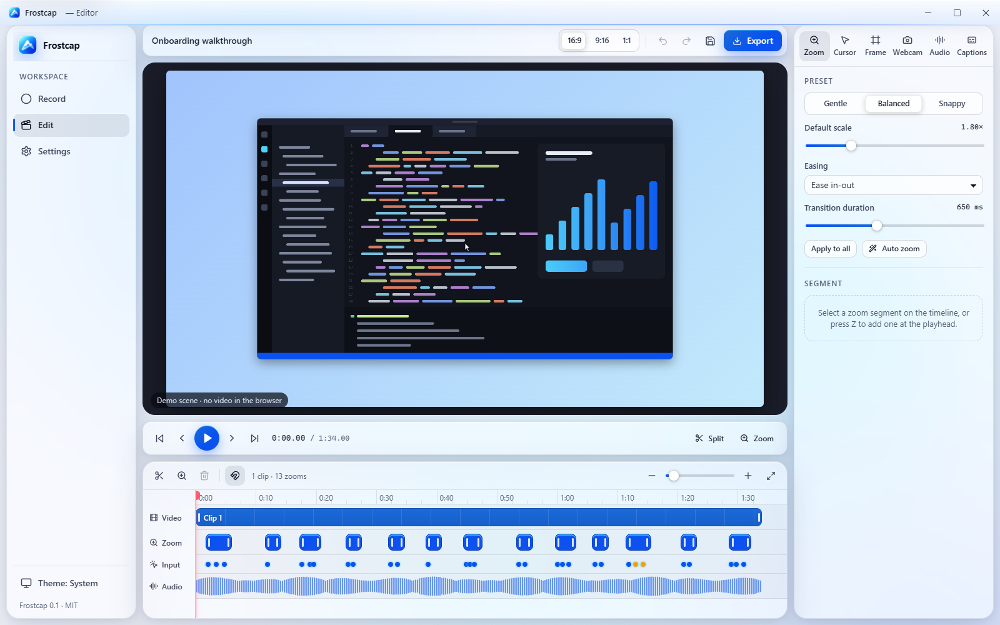

<p align="center">
  
</p>

<h1 align="center">Frostcap</h1>

<p align="center">
  A free, open-source screen recorder and editor for Windows.<br>
  Record your screen, let Frostcap zoom in where the action is, polish it, export it.<br>
  <strong>No account. No network. No telemetry. MIT licensed.</strong>
</p>

<p align="center">
  <a href="LICENSE"></a>
  
  
</p>

> **Status: 0.1.0 pre-release.** There is no published release yet; build from source to try it.
> Everything below is implemented and covered by tests; the app has not had broad real-world testing yet.

## Features

**Record**
- Record a whole monitor, a single window, or a region you draw, with a 3-2-1 countdown and the Windows capture border on.
- Webcam, microphone and system audio, each on its own track, all on one clock.
- Pause and resume (paused spans are cut from every track). Global hotkeys: Ctrl+Alt+Shift+R start/stop, Ctrl+Alt+Shift+P pause (configurable).
- Cursor path, clicks and window focus are recorded alongside the video so the cursor and zooms can be re-rendered later.
- Optional keystroke capture for a key overlay: off by default; "shortcuts only" or "all keys" (with a password warning).
- Crash-safe: fragmented MP4 plus recovery files. If Frostcap or Windows stops mid-recording, the recording can be recovered with at most about a second lost.

**Edit**
- Automatic zoom that follows your clicks and typing (gentle, balanced or snappy), with every zoom editable on the timeline.
- Timeline with trims, splits, undo/redo and keyboard shortcuts; real video and audio preview with a waveform.
- Smooth, resizable cursor with motion blur and click ripples, or hide it.
- Backgrounds (gradients), padding, rounded corners, shadow and window frames (none, minimal, Windows, macOS).
- Webcam bubble (circle, rounded or square, any corner and size).
- Captions: import SRT/VTT, choose size, position and background.
- Audio: per-track gain and mute, noise gate, high-pass filter and loudness normalisation for the mic.

**Export**
- GPU compositor (wgpu on DirectX 12) renders every edit into a new MP4 (H.264 + AAC through Windows Media Foundation, hardware encoder when available) or an animated GIF.
- 16:9, 9:16 and 1:1 presets, resolution and frame rate options, progress and cancel. Falls back to software rendering when no GPU is available.

**Principles**
- Free and MIT licensed: no watermarks, no paywalls, no account.
- No network requests, no telemetry. Everything stays on your PC.
- Only permissive open-source dependencies (checked in CI); no bundled codecs.
- Glassmorphism interface in the Frostcap palette, with a solid mode for reduced transparency, light and dark themes, and full keyboard support.

## Screenshots

**Recorder:** pick a display, window or region, toggle webcam, mic, system audio and cursor polish.


**Editor:** auto-zoom segments, input markers and audio waveform on the timeline, with the inspector for zoom, cursor, frame, webcam, audio and captions.


**Light theme**



<sub>Screenshots use the built-in demo data (the browser preview mode), so the preview shows a demo scene instead of a real recording.</sub>

## Privacy

Frostcap works entirely on your computer.

- It makes **no network requests**: no update checks, no analytics, no crash reporting, no
  accounts. The app's Content Security Policy only allows local resources.
- Recordings and settings stay on your disk (by default under `Videos\Frostcap`).
- Keystroke capture is **off by default**. When you turn it on, only key-downs are stored in
  the project file, never text.
- Recorded projects can contain window titles and other details; check before you share one.

Full details, including what each file contains and how to delete it: [docs/PRIVACY.md](docs/PRIVACY.md).

## Install

There is no release yet. When there is, it will be on the
[Releases](../../releases) page as:

- `Frostcap_<version>_x64-setup.exe` - installer
- `Frostcap_<version>_x64-portable.exe` - single exe, no installation
- `SHA256SUMS.txt` - checksums ([how to verify](docs/RELEASING.md#verifying-a-download))

**Requirements**

- Windows 11, or Windows 10 x64 (version 2004 or newer recommended). Windows 11 is the
  main target: on Windows 10 some capture options are limited by the OS (for example the
  capture border cannot be hidden) and the Mica backdrop is not available. Windows 10
  support is less tested.
- **Microsoft Edge WebView2 Runtime (Evergreen)**, which draws the user interface. It is
  preinstalled on Windows 11 and on up-to-date Windows 10. The installer can fetch it if it
  is missing; the portable exe needs it already installed
  ([download from Microsoft](https://developer.microsoft.com/microsoft-edge/webview2/)).
- **Windows N / KN editions** do not include Media Foundation codecs. Install the
  [Media Feature Pack](https://support.microsoft.com/topic/media-feature-pack-list-for-windows-n-editions-c1c6fffa-d052-8338-7a79-a4bb980a700a)
  first, or recording will fail.

Early builds are not code-signed, so Windows SmartScreen may show "Windows protected your PC".
Verify the checksum, then choose "More info" -> "Run anyway" if you trust the download.

## Build from source

Prerequisites (all free):

- Windows 10/11 x64
- [Rust](https://rustup.rs/) via rustup. The exact toolchain (1.100.0, with clippy and
  rustfmt) is pinned in [`rust-toolchain.toml`](rust-toolchain.toml) and installed automatically.
- MSVC build tools: "Visual Studio Build Tools" with the **Desktop development with C++**
  workload (MSVC + Windows SDK). The free Build Tools edition is enough.
- [Node.js](https://nodejs.org/) 20 or newer (CI uses 24) with npm
- WebView2 Runtime (see above)

```powershell
git clone <repository-url> frostcap
cd frostcap

# Optional: keep the Rust toolchain, cargo cache and build output inside the repo
# (useful when the system drive is small). Do this in every new shell.
. .\env.ps1

# 1. Build the UI (embedded into the exe at compile time)
cd ui
npm ci                     # with env.ps1: npm ci --cache ..\.toolchain\npm-cache
npm run build              # typecheck + vite build -> ui/dist
cd ..

# 2. Build and run the app
cargo run -p frostcap --release
```

The release binary is `target\release\frostcap.exe`. It statically links the C runtime, so it
is a single file (WebView2 is still required).

**UI development with hot reload:** run `npm run dev` in `ui/` (Vite on port 5173), then
`cargo run -p frostcap --no-default-features` in another terminal. The UI also runs in a normal
browser against a mock backend (`npm run dev`, open the printed URL), which is handy for
layout work.

**Checks** (the same ones CI runs):

```powershell
cargo fmt --all -- --check
cargo clippy --workspace --all-targets -- -D warnings
cargo test --workspace
cargo deny check                       # license policy + RustSec advisories
node scripts/gen-third-party.mjs --check
cd ui; npm run typecheck; npm run build
```

Smoke tests that touch real hardware: `cargo run -p frostcap-core --example record`
(records a few seconds of the primary monitor and validates the MP4).

**Installer:** see [docs/RELEASING.md](docs/RELEASING.md). The bundler is off in
`tauri.conf.json` for day-to-day builds and enabled only for releases.

## Notes on H.264 and WebView2

- Frostcap does **not** ship a video codec. It asks Windows' own Media Foundation for its
  H.264 (and AAC) encoder, using a hardware encoder from your GPU vendor when one is
  available. This is why N editions need the Media Feature Pack, and why there is no FFmpeg.
- The interface is a web UI rendered by the system WebView2 (Chromium-based Edge) runtime.
  Frostcap does not bundle or modify it.
- Legal background (licenses, codec patents, WebView2 terms, trademarks):
  [docs/LEGAL.md](docs/LEGAL.md). It is not legal advice.

## Project layout

```
assets/brand/            logo master (logo.png) and source
assets/screenshots/      README screenshots (demo data)
crates/frostcap-project/ project.json types and validation (shared, serde only)
crates/frostcap-core/    capture, audio, webcam, input metadata, recovery, auto-zoom, hotkeys (no UI)
crates/frostcap-render/  export renderer: decode -> GPU compositor -> encode, GIF
crates/frostcap-export/  export orchestration (validate, render or copy, atomic output)
crates/option-ext-shim/  MIT replacement for the MPL-2.0 option-ext crate
src-tauri/               Tauri 2 app shell (window, commands) -> frostcap.exe
ui/                      React + TypeScript + Vite user interface
docs/                    architecture, UI, brand, privacy, legal, releasing
scripts/                 license inventory, full verification sweep (full-scan.ps1)
.github/                 CI, release workflow, templates, Dependabot
deny.toml                dependency license and advisory policy (cargo-deny)
env.ps1                  optional repo-local toolchain environment
```

A recording is a folder, `<name>.frostcap/`, holding `screen.mp4`, optional `webcam.mp4`,
`audio-mic.wav`, `audio-system.wav` and `project.json` (tracks and edits). See
[docs/ARCHITECTURE.md](docs/ARCHITECTURE.md#project-format).

## Contributing

Contributions are welcome: bug reports, testing on different hardware, code and docs.
Read [CONTRIBUTING.md](CONTRIBUTING.md) first; it covers the dependency license policy
(permissive licenses only) and the no-network rule. Please follow the
[Code of Conduct](CODE_OF_CONDUCT.md). Report security issues privately as described in
[SECURITY.md](SECURITY.md).

## License

Frostcap is released under the [MIT License](LICENSE). Third-party components and their
licenses are listed in [THIRD_PARTY_LICENSES.md](THIRD_PARTY_LICENSES.md).

The Frostcap name and logo: see the trademark note in [docs/LEGAL.md](docs/LEGAL.md#name-and-logo).
